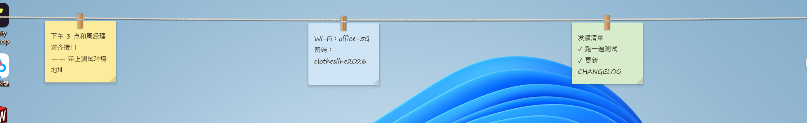
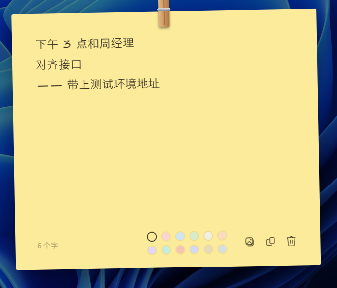
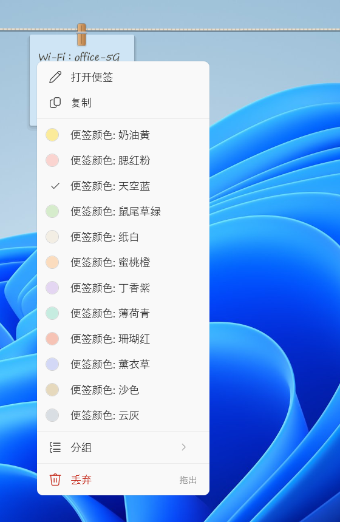
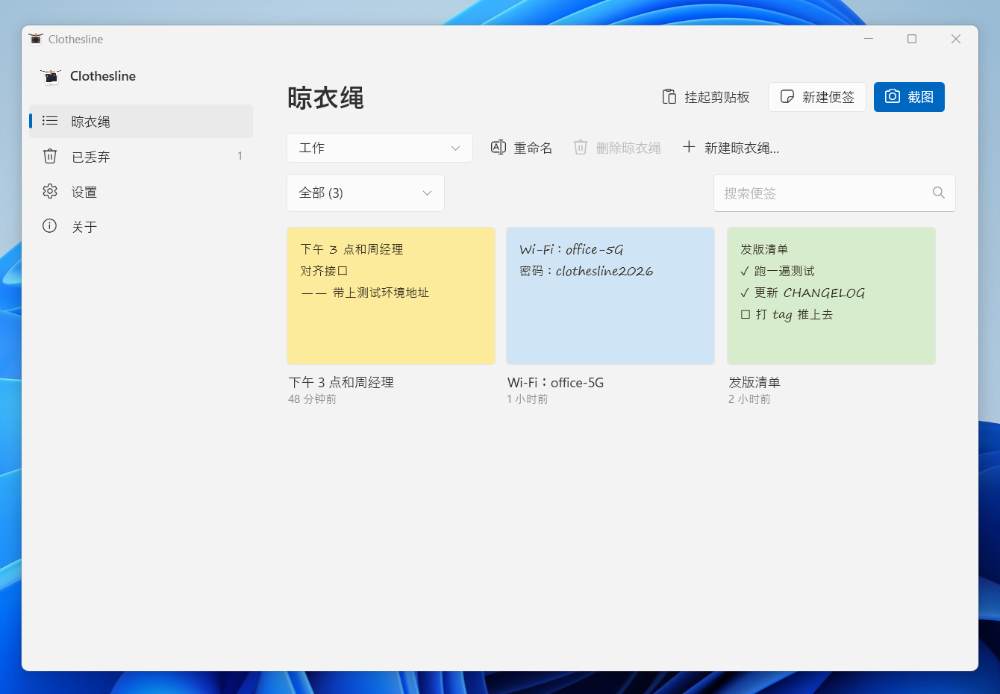
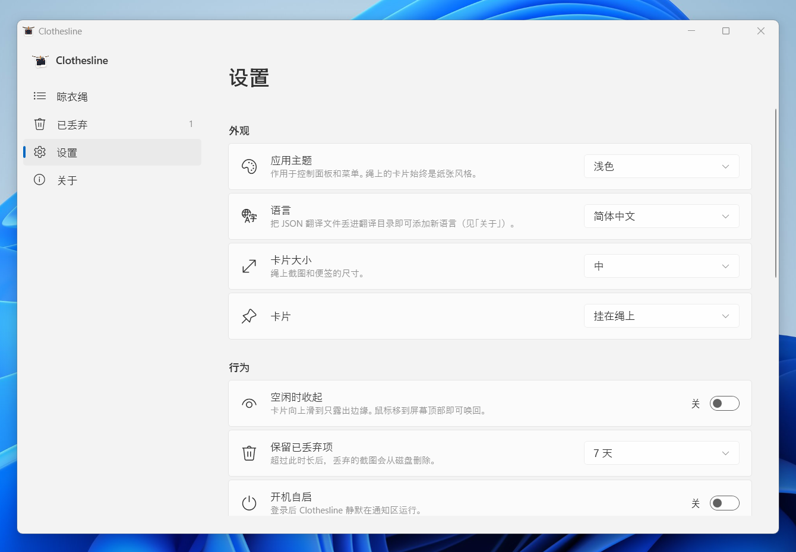

<p align="center">
  
</p>

<h1 align="center">Clothesline</h1>

<p align="center">
  Hang screenshots, notes and live app windows on a clothesline across the top of your screen.<br>
  A small, native Windows utility. Free and open source.
</p>

<p align="center">
  <a href="#features"><b>Features</b></a> ·
  <a href="#live-app-windows">App windows</a> ·
  <a href="#screenshots">Screenshots</a> ·
  <a href="#shortcuts">Shortcuts</a> ·
  <a href="#build-from-source">Build</a>
</p>

<p align="center">
  
  <a href="LICENSE"></a>
</p>

<p align="center">
  
</p>

A clothesline holds the things you need for the next few minutes — part of a design, an error message, a
phone number, the app you keep switching to — where you can see them, instead of buried in a folder or
under a pile of windows.

## Why I built this

During a normal workday I keep a lot of small things around: a screenshot of a bug, a colour from a
design, a client's address, a checklist for a deploy. I used to keep them in a notes app or leave them
as files and open windows on my desktop. Before long there were too many, they were scattered
everywhere, and I kept losing track of what was where.

Then a simple idea came to me: what if they just hung along the top of the screen, like clothes on a
line? Always there when I glance up, out of the way when I don't need them, and easy to take down when
I'm done. That idea became this app. It has made my own work noticeably tidier, so I'm sharing it in
case it helps you too.

## Features

- **Screenshot straight to the line.** <kbd>Alt</kbd> <kbd>Shift</kbd> <kbd>S</kbd>, then drag an area, click a window, or press <kbd>Enter</kbd> for the whole screen. The capture drops onto the line with a little swing.
- **Notes on paper.** <kbd>Alt</kbd> <kbd>Shift</kbd> <kbd>N</kbd> brings a sheet to the middle of the screen. Type, pick one of twelve colours, click outside — it hangs itself back up.
- **App windows as launchers.** Drag any window by its title bar to the top of the screen: the line is summoned and a *hangable* slot appears on the right. Let go and the window is captured, hung as a card showing that picture, and **minimised** — click the card to bring it back. See [Live app windows](#live-app-windows).
- **Bring anything closer.** Click a card and it comes to the middle of the screen, where you can copy, mark up, open or save it.
- **Share by dragging.** Pull a card down off the line and drop it into WhatsApp, Slack, an email or a folder — anything that accepts files.
- **Let it go.** Drop a card on empty space and it falls away. It waits in *Discarded* for a week (configurable) in case you change your mind.
- **Mark up.** Press and hold a screenshot to draw on it with a pen, highlighter, box or arrow.
- **Out of sight.** When you're not using it, the line tucks itself away and only the bottom edges of the cards peek out. Touch the top of the screen to bring it back.
- **Take everything in.** <kbd>Alt</kbd> <kbd>Shift</kbd> <kbd>J</kbd> or a left-click on the tray icon lifts every card out of sight. Do it again and they hang back out.
- **More than one line.** Keep a line per project or task. Click the name tag at the left end of the rope to switch, or press <kbd>Alt</kbd> <kbd>Shift</kbd> <kbd>G</kbd> for the next line. Cards move between lines from their right-click menu.
- **Groups.** Gather related cards into a named group on the line. Drag a card into a group to join it, drag the label to move the whole group, and click the label to fold the group into a stack.
- **Desktop mode.** <kbd>Alt</kbd> <kbd>Shift</kbd> <kbd>M</kbd> (or the tray menu) lets every card go free on the desktop, above your other apps, with no limit. Press it again and they hang back on the line.
- **Resize cards.** On the desktop, drag a card's corner to make it bigger or smaller. Notes keep their text size and show more or less of it; screenshots keep their shape. Double-click the corner to reset.
- **Feels like Windows.** Light and dark mode, your accent colour, Mica, keyboard shortcuts you can change, and a tray icon that matches your taskbar.

## Live app windows

The line is not only for pictures. Any window can hang on it and turn into a one-click launcher.

1. **Drag a window by its title bar** to the top of the screen. The line slides out and a dashed slot
   labelled *Hang: <window title>* appears on the right, with a clothespin waiting for it.
2. **Let go in the hot zone.** The window is snapped to a picture, which becomes the front of a card,
   and the source window is minimised — the line takes its place.
3. **Click the card** to restore and raise that window. The card refreshes its picture a moment later,
   so it always shows what you last saw.
4. **If the window is gone**, the card holds the app's executable path and starts it again, then binds
   itself to the new window. Cards survive a restart, so the line doubles as an app bar.

The window title is kept with the card, so a line of browser windows, editors and terminals stays
readable at a glance.

Works with classic Win32 windows as well as the newer Windows 11 ones — Notepad, Explorer, Settings and
any WinUI app put a separate child window over the title bar, and the line asks that one before falling
back to the top-level window.

You can also hang the window you are already using without dragging: <kbd>Alt</kbd> <kbd>Shift</kbd>
<kbd>E</kbd> opens a picker of every open window, or use **Hang this window** from the tray menu.

## Screenshots

<table>
  <tr>
    <td width="50%"></td>
    <td width="50%"></td>
  </tr>
  <tr>
    <td align="center"><sub>A note, taken off the line to write on</sub></td>
    <td align="center"><sub>Every action is a right-click away</sub></td>
  </tr>
  <tr>
    <td></td>
    <td></td>
  </tr>
  <tr>
    <td align="center"><sub>Everything on the line, in one place</sub></td>
    <td align="center"><sub>Settings, following the Windows 11 style</sub></td>
  </tr>
</table>

## Install

There is no prebuilt download for this fork yet — build it from source (below). The original project's
installer and portable builds are [here](https://github.com/revanapriyandi/jemur/releases).

Clothesline keeps your library in `%APPDATA%\Clothesline` and lives in the notification area. Turn on
**Settings → Start with Windows** if you want it to start when you sign in. A first run over an existing
Jemur library moves it across automatically.

Runs on Windows 10 (1809 or later) and Windows 11. Mica and rounded corners appear on Windows 11.

## Updates

The update checker reads the public manifest of the original project and is off by default in this
fork's settings file. Turn it off entirely under **Settings → Update automatically** if you build your
own copy. Open **About** and choose **Check for updates** to check right away.

## Shortcuts

| Action | Default |
|---|---|
| Take a screenshot | <kbd>Alt</kbd> <kbd>Shift</kbd> <kbd>S</kbd> |
| New note | <kbd>Alt</kbd> <kbd>Shift</kbd> <kbd>N</kbd> |
| Hang whatever is on the clipboard (image, image file or text) | <kbd>Alt</kbd> <kbd>Shift</kbd> <kbd>V</kbd> |
| Hang an open window | <kbd>Alt</kbd> <kbd>Shift</kbd> <kbd>E</kbd> |
| Take everything in / hang it back out | <kbd>Alt</kbd> <kbd>Shift</kbd> <kbd>J</kbd> |
| Switch between line and desktop mode | <kbd>Alt</kbd> <kbd>Shift</kbd> <kbd>M</kbd> |
| Next line | <kbd>Alt</kbd> <kbd>Shift</kbd> <kbd>G</kbd> |
| Open Clothesline | <kbd>Alt</kbd> <kbd>Shift</kbd> <kbd>P</kbd> |

Change any of them under **Settings → Keyboard shortcuts**. A left-click on the tray icon also takes
everything in or hangs it back out; Clothesline itself opens from the tray menu or <kbd>Alt</kbd>
<kbd>Shift</kbd> <kbd>P</kbd>. In the mark-up editor: <kbd>P</kbd> pen, <kbd>H</kbd> highlighter,
<kbd>R</kbd> box, <kbd>A</kbd> arrow, <kbd>E</kbd> eraser, <kbd>Ctrl</kbd>+<kbd>Z</kbd> /
<kbd>Ctrl</kbd>+<kbd>Y</kbd> undo and redo.

## Light on resources

Clothesline sits in the background all day, so it's built to stay small:

- no WinForms or System.Drawing — the tray icon, shortcuts and screen capture talk to Win32 directly;
- thumbnails are decoded at the size they're shown and shared between views, never at full resolution;
- nothing animates or polls while the line is idle, and the line window shrinks to a thin strip when tucked away;
- memory is handed back to Windows after the heavy moments — a capture, closing the control panel.

Tucked away, it shows about **3 MB** in Task Manager's *Memory* column, with or without items on the
line. While the line or the control panel is on screen it uses more (roughly 30–80 MB, mostly WPF's
renderer) and gives it back once it's tucked away again. Measurements and how to reproduce them:
[docs/MEMORY.md](docs/MEMORY.md).

## Privacy

Everything stays on your PC. Screenshots, notes and app cards live in `%APPDATA%\Clothesline`. There is
no telemetry and no account. App cards store only the window title and the executable path, never the
window contents. Clothesline only goes online to check for updates and, when a note contains a web
address, to fetch that one page's title and picture for its preview.

## Languages

English, Bahasa Indonesia, Spanish, Portuguese (Brazil), Japanese, Bahasa Melayu and Simplified Chinese
are included. Adding a language is a single JSON file and no code — see
[docs/TRANSLATING.md](docs/TRANSLATING.md). Native speakers are welcome to suggest wording improvements.

## Build from source

```powershell
git clone https://github.com/chengguojin1/clothesline
cd clothesline
dotnet run --project src
```

Requires the [.NET 10 SDK](https://dotnet.microsoft.com/download/dotnet/10.0). [CONTRIBUTING.md](CONTRIBUTING.md)
covers the project layout, tests and guidelines. `dotnet test` runs the 144 unit tests.

## Credits

A fork of [Jemur](https://github.com/revanapriyandi/jemur) by
[M. Revan Apriyandi](https://github.com/revanapriyandi), itself inspired by Tendedero, a macOS app by
[@alejandr0bujan](https://x.com/alejandr0bujan). This fork adds live application windows — hang, restore
and relaunch — and Simplified Chinese. Both projects are MIT-licensed and share no code with Tendedero.

## License

[MIT](LICENSE) © 2026 M. Revan Apriyandi
